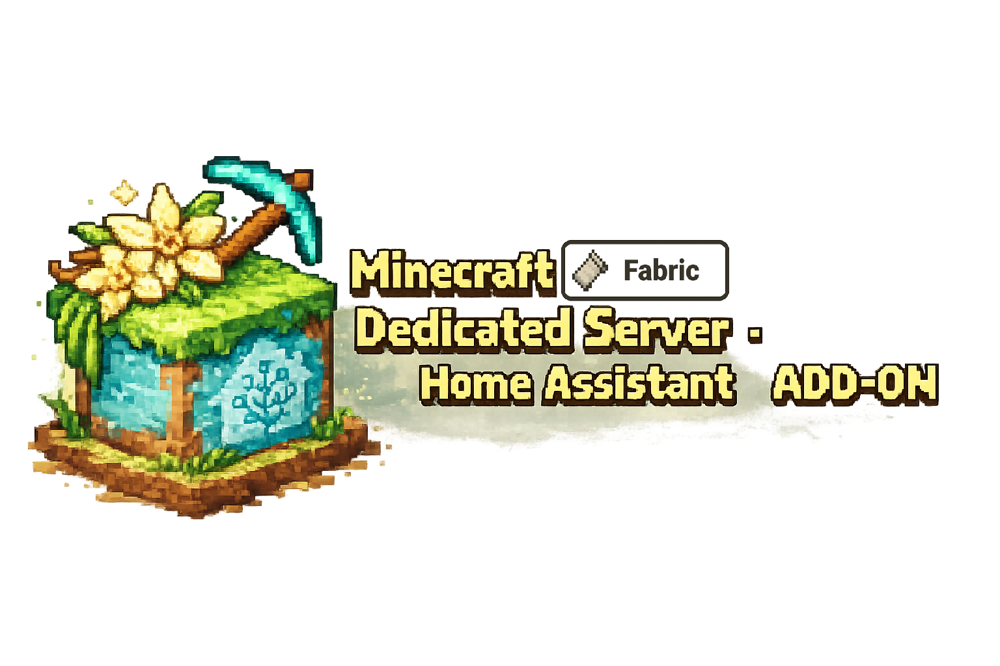

  

  
  
  
  
  

---

<h1>Minecraft Fabric Dedicated Server</h1>

This Home Assistant Add-on allows you to run a **Minecraft Fabric Dedicated Server**
directly on **Home Assistant OS**, fully managed by the Supervisor.

It is designed to be:

- simple
- headless
- reproducible
- configurable via the Home Assistant UI
- suitable for LAN and private servers

---

## ✨ Features

- Automatic **Java installation** (Temurin)
- Automatic **Fabric server installation** (no mods by default)
- Automatic **Minecraft server download**
- **EULA is always accepted automatically**
- Fixed **container port 25565** (host port configurable via HA UI)
- Configurable **RAM settings** (`Xms` / `Xmx`)
- Persistent server data stored in `/share`
- Live Minecraft server output in the Home Assistant add-on log
- Additional persistent log file
- Runs fully inside **Home Assistant OS**
- No external server or launcher required

---

## 📂 Server Files Location

All server files are stored persistently in:

/share/minecraft-fabric/servers/<server_name>/
├── fabric-server-launch.jar
├── mods/
├── world/
├── logs/
└── .jre/

You can freely edit:
- `server.properties`
- worlds
- logs
- and other server configuration files

---

## 🔧 Installation

1. Open **Home Assistant**
2. Go to **Settings → Add-ons → Add-on Store**
3. Add this repository if not already added:

https://github.com/cyclemat/Home-Assistant-Gameservers-ADDONS

4. Install **Minecraft Fabric Dedicated Server**
5. Configure the add-on
6. Start the server

---

## ⚙️ Configuration Options

| Option | Description |
|-----|------------|
| `server_name` | Server name used as folder under `data_dir/servers` |
| `mc_version` | `latest` or a specific Minecraft version (e.g. `1.21.1`) |
| `fabric_loader_version` | `latest` or a specific Fabric loader version |
| `fabric_installer_version` | `latest` or a specific Fabric installer version |
| `xms_mb` | Minimum RAM (MB) |
| `xmx_mb` | Maximum RAM (MB) |

> ℹ️ For mod compatibility, set `mc_version` explicitly and match your Fabric loader to that Minecraft version.

> ℹ️ The Minecraft server always runs on port **25565 inside the container**.  
> The external port can be changed in the Home Assistant add-on network settings.

---

## 🧪 Architecture & Status

- **amd64**: tested and working
- **arm64**: should work, but **not yet fully tested**

ARM64 support is implemented (Java + server are architecture-aware),
but real-world feedback is highly appreciated.

👉 If you are running this add-on on **ARM64 hardware**
(e.g. Home Assistant Green, Raspberry Pi 64-bit),
please consider testing it and sharing your results.

---

## ❤️ Feedback & Support

This add-on is developed and maintained in my free time.

If you try it out:
- feedback
- bug reports
- improvement suggestions
- ARM64 test results

are very welcome and highly appreciated.

---

> **“Every block placed is a step into your own story.”**  
> *— inspired by Minecraft*
